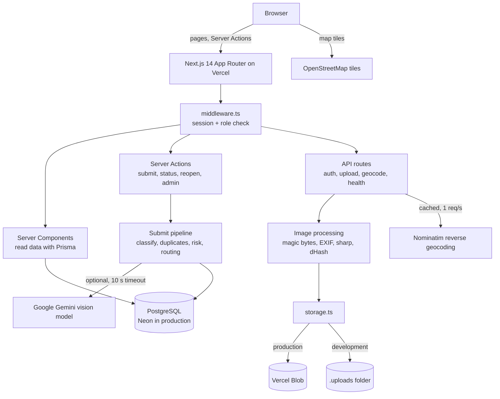

# JanSetu

**Smart Grievance Redressal & Fake Complaint Detection System**
Course project for INT257, Modern Web Application Development.

> Academic project, not affiliated with any government body. Complaints submitted here are not sent to any authority.

- **Live deployment:** _to be added after the Vercel deployment (see [Deploy](#deploy-vercel--neon--vercel-blob))_
- **Repository:** https://github.com/Ankit28max/next-project
- **Team:** Abhinav Singla (12408467), Ankit Singh (12407308), Devansh (12407745)

## What it is

A grievance portal where a citizen reports a civic problem (pothole, garbage, water, drainage, streetlight) with a description, a pinned map location and one photo. The system then:

1. checks and cleans the photo, and computes a visual fingerprint of it;
2. suggests a category (keyword rules, plus a vision model when configured);
3. links likely duplicates of the same incident;
4. gives officers a risk score with written reasons for possibly fake or misleading submissions;
5. routes the complaint to a department and to the officer with the fewest open cases.

**The automatic analysis is advisory.** It never rejects a complaint. A human officer reads the reasons and decides.

## Features

| Role | What they can do |
|---|---|
| Visitor | Read how the system works; track any complaint's status by reference number (status, category and department only) |
| Citizen | Register, submit a complaint through a 4-step wizard, follow the status timeline, reopen a closed complaint, read notifications |
| Officer | See the queue of their own department with filters, review a complaint (photo, map, analysis, risk reasons, side-by-side duplicate comparison), update status, add internal notes |
| Admin | Dashboard with counts, all complaints, manual reassignment, create/deactivate officers, edit routing rules, audit log |

## Architecture



Folder guide:

```
prisma/            schema, migrations, demo seed, production seed
src/app/           pages (App Router), API routes, loading/error/not-found
src/actions/       Server Actions
src/lib/auth/      JWT session, role and ownership checks
src/lib/images/    upload validation, EXIF, dHash, browser-side resize
src/lib/ai/        config, rules classifier, Gemini call, duplicates, risk, routing
src/lib/complaints submit pipeline, status workflow, reference numbers
src/components/    UI components
eval/              labelled evaluation set and synthetic photos
scripts/           eval runner, eval image generator
tests/             unit tests (Vitest) that import the real application code
docs/              REPORT, VIVA, DEMO_SCRIPT, PROGRESS
```

## Technology

Next.js 14.2 (App Router, Server Components, Server Actions), React 18, TypeScript, Tailwind CSS, PostgreSQL with Prisma 5, `jose` (JWT), `bcryptjs`, `zod`, `sharp`, `exifr`, Leaflet + OpenStreetMap, Vercel Blob, Google Gemini (optional), Vitest.

## Prerequisites

- Node.js 20.6 or newer (developed on Node 22)
- Docker (for the local PostgreSQL database)

## Installation (local)

```bash
git clone https://github.com/Ankit28max/next-project.git
cd next-project
npm install                       # also runs `prisma generate`

npm run db:up                     # starts PostgreSQL in Docker on port 5433

cp .env.example .env.development.local
# edit .env.development.local: set JWT_SECRET (openssl rand -base64 48)

npm run db:migrate                # applies the migrations
npm run seed:demo                 # LOCAL ONLY: wipes the database and loads demo data
npm run dev                       # http://localhost:3000
```

To run a production build locally, copy the same file to `.env.production.local`, then `npm run build && npm start`.

## Configuration

| Variable | Required | Purpose |
|---|---|---|
| `DATABASE_URL` | yes | PostgreSQL connection used by the app. On Neon: the **pooled** connection string |
| `DIRECT_URL` | yes | Connection used by `prisma migrate`. On Neon: the **direct** connection string. Locally: same as `DATABASE_URL` |
| `JWT_SECRET` | yes | Signs session cookies. At least 32 characters. The server refuses to start without it; there is no default |
| `GEMINI_API_KEY` | no | Google AI Studio key. Without it the app runs on keyword rules only, and says so in the UI |
| `GEMINI_MODEL` | no | Vision model name (default `gemini-3.5-flash-lite`) |
| `BLOB_READ_WRITE_TOKEN` | on Vercel | Set automatically when a Vercel Blob store is linked. Without it, photos go to the local `.uploads/` folder (development only) |
| `SEED_ADMIN_PASSWORD`, `SEED_OFFICER_PASSWORD`, `SEED_CITIZEN_PASSWORD` | for `seed:prod` | Passwords for the accounts created by the production seed (10+ characters) |
| `GEOCODER_CONTACT` | no | Contact address sent in the User-Agent to OpenStreetMap Nominatim, as its usage policy asks |

Which file holds what:

- `.env.development.local` and `.env.production.local`: local Docker database. Used by `npm run dev`, `db:migrate`, `seed:demo` and local production builds.
- `.env.local`: the real Neon and Gemini values. Used by `npm run seed:prod` and `npm run eval`.
- All `.env*` files except `.env.example` are ignored by git.

## Commands

| Command | What it does |
|---|---|
| `npm run dev` | Development server |
| `npm run build` / `npm start` | Production build / run it |
| `npm run lint` | ESLint |
| `npm run typecheck` | TypeScript check |
| `npm test` | Unit tests |
| `npm run eval` | Runs the labelled evaluation set and prints accuracy, precision, recall |
| `npm run db:up` | Start local PostgreSQL |
| `npm run db:migrate` | Create/apply migrations on the local database |
| `npm run seed:demo` | **Local only.** Deletes everything, then loads demo accounts and complaints. Refuses to run with `NODE_ENV=production` or against a non-local database |
| `npm run seed:prod` | Non-destructive: creates departments, categories, 1 admin, 4 officers, 1 demo citizen if they do not exist |

## Demo accounts

Created by both seeds (the production seed uses the passwords you set in `SEED_*`; for the demo deployment set them to the values below).

| Role | Email | Password |
|---|---|---|
| Citizen | `citizen@jansetu.example` | `Citizen#2026demo` |
| Officer (Public Works) | `officer.pwd@jansetu.example` | `Officer#2026demo` |
| Officer (Water) | `officer.water@jansetu.example` | `Officer#2026demo` |
| Officer (Electricity) | `officer.elec@jansetu.example` | `Officer#2026demo` |
| Officer (Sanitation) | `officer.sanitation@jansetu.example` | `Officer#2026demo` |
| Admin | `admin@jansetu.example` | `Admin#2026demo` |

These are throwaway demo credentials for an academic project. They are never shown in the application itself.

## Usage

**Citizen**

1. Register (or sign in with the demo citizen).
2. *Report a problem*: (1) title and description, (2) click the map or press *Use my location*, then check the address, (3) add one photo, (4) review, tick the consent box, submit.
3. The result screen shows the reference number, category and department.
4. *My complaints* shows the status timeline. A resolved or rejected complaint can be reopened with a reason.
5. Anyone can check a reference number on the *Track* page without signing in.

**Officer**

1. Sign in. *Overview* shows open cases, cases assigned to you and reopened cases.
2. *Complaint queue*: filter by status, risk level, "assigned to me", or search.
3. Open a complaint: read the report, the automatic analysis, the risk reasons and any possible duplicates side by side.
4. *Update status* with a remark (the citizen sees it), or add an internal note (staff only).

**Admin**

1. *Dashboard*: counts, complaints per department and status, and how many were categorised by the vision model vs. rules.
2. *Complaints*: everything, including the "needs manual triage" filter. Open one to reassign it to a department/officer.
3. *Officers*: create an officer account, deactivate or reactivate one.
4. *Routing rules*: keywords that send a complaint to a specific department before the category default.
5. *Audit log*: who did what.

## How the analysis works (honestly)

Everything below runs on the server. The numbers come from one file: `src/lib/ai/config.ts`.

**On upload** (`src/lib/images/process.ts`)
- The file type is detected from its first bytes; the browser's file name and MIME type are ignored. Maximum 4 MB.
- A few EXIF facts are read (capture time, GPS, device, software) and stored. Then the photo is re-encoded with `sharp`, which removes all metadata; only the cleaned JPEG is stored.
- A 64-bit **dHash** is computed: the image is shrunk to 9×8 grey pixels and each pixel is compared with its right-hand neighbour. Two hashes that differ in at most 10 of 64 bits are treated as the same photo.

**On submit** (`src/lib/complaints/submit.ts`): one database transaction.

| Step | What is rule-based | What the vision model adds |
|---|---|---|
| 1. Category | Weighted whole-word keywords in English and Hinglish, fixed tie-break order. Always runs | If `GEMINI_API_KEY` is set: the photo and text are sent to Gemini, which returns JSON (category, severity, `imageMatchesText`, `looksLikeStockOrScreenshot`, reasons). The answer is validated with zod. On any failure (timeout, HTTP error, invalid JSON) the rules result is used and the record says "rules" plus the reason |
| 2. Duplicates | SQL pre-filter (within 500 m, last 60 days, not rejected), then a score from text similarity 35%, distance 35%, same category 15%, same photo 15%. Score ≥ 0.6 links the two complaints | nothing |
| 3. Risk score | Same photo used by another citizen, photo GPS far from the pin, old photo, missing EXIF (weak), editing software in metadata, filler text, many submissions in 10 minutes, resubmitting one's own complaint | Photo does not match the text; photo looks like a stock image or screenshot |
| 4. Routing | Admin keyword rules → category default department → least-loaded active officer | nothing |

- The rules produce a **match strength** (sum of keyword weights). It is **not a probability** and is never shown as a percentage.
- The risk score is 0–100; 30+ is "medium", 60+ is "high". Every point has a written reason. Only staff see it.
- If the analysis fails, the complaint is saved as **needs manual triage** with no risk level at all (never "low").
- Without a Gemini key the app shows "Running on fallback keyword rules" to staff, and `/api/health` reports `rules only`.

## Measured results

From `npm run eval` on the 33 labelled cases in `eval/dataset.ts` (English and Hinglish; 5 duplicate pairs; 5 suspicious cases; **synthetic photos**). Run on 15 Nov 2026, twice: keyword rules only, and with the vision model `gemini-3.5-flash-lite`.

| Measure | Rules only | With vision model |
|---|---|---|
| Category accuracy | 31 / 33 = 93.9% | 33 / 33 = 100% |
| Duplicate detection precision | 5 / 5 = 100% | 5 / 5 = 100% |
| Duplicate detection recall | 5 / 5 = 100% | 5 / 5 = 100% |
| Suspicious flag precision (risk ≥ 30) | 3 / 5 = 60% | 5 / 26 = 19.2% |
| Suspicious flag recall | 3 / 5 = 60% | 5 / 5 = 100% |

How to read this:

- **Category.** Rules missed two cases: "Bikes keep skidding at the turn" (no road keyword, filed as Other) and a Hinglish drain complaint containing *ganda pani* (filed as Water Supply). The vision model got both.
- **Suspicious flag, rules only.** Two false alarms (a neighbour who forwarded the same photo of a real burst pipe; a citizen who re-sent their own unresolved complaint) and two misses (a screenshot used as a "photo"; a garbage photo on a streetlight complaint), because rules cannot see photo content.
- **Suspicious flag, with the vision model.** It caught all five, but it also flagged 21 genuine cases. The reason is our test data, not the complaints: the evaluation photos are simple drawings, and the model correctly reports that they are "not a real photo" or "look like a graphic". **So the vision model's fraud precision cannot be measured with this set.** It needs real photographs, which we did not have permission to collect. The 19.2% is what happened on this set and should not be read as real-world precision in either direction.

**Caveat:** a small set written by the team, with synthetic drawings instead of real photos. The numbers describe this set only.

**Vision model notes:** the free Gemini tier allows about 15 requests per minute; above that the API answers 429 and the app falls back to rules (recorded per complaint). During testing the API was also sometimes slow enough to hit our 10-second timeout, with the same fallback.

## Tests

`npm test` runs 62 unit tests that import the real code: classification, duplicate scoring, risk scoring, hashing and upload processing, routing and reference numbers, authorization, sessions and rate limiting.

## Deploy (Vercel + Neon + Vercel Blob)

1. **Neon:** create a project. Copy the *pooled* connection string and the *direct* connection string.
2. **Vercel:** import the GitHub repository. In *Settings → Environment Variables* add `DATABASE_URL` (pooled), `DIRECT_URL` (direct), `JWT_SECRET` (`openssl rand -base64 48`), and optionally `GEMINI_API_KEY`, `GEMINI_MODEL`, `GEOCODER_CONTACT`.
3. **Vercel Blob:** *Storage → Create → Blob*, link it to the project. This adds `BLOB_READ_WRITE_TOKEN`.
4. Deploy. Vercel runs `npm run vercel-build`, which applies migrations (`prisma migrate deploy`) and then builds.
5. **Seed once**, from your machine: put the Neon URLs and the three `SEED_*` passwords in `.env.local`, then `npm run seed:prod`.
6. Check `https://<your-app>/api/health`.

Never run `npm run seed:demo` against production (it refuses to).

## Security notes

- Sessions: JWT in an `httpOnly`, `SameSite=Lax` cookie (`Secure` in production), 7 days. The user is re-read from the database on every request, so deactivated accounts stop working at once.
- Deny by default: every page, API route and Server Action calls `requireRole`; every complaint read/write passes `canAccessComplaint`.
- All input is validated with zod. Pagination is capped at 50.
- State-changing API requests must come from the same origin; Server Actions have Next.js's built-in origin check.
- Rate limits on login, registration, upload, submit, tracking and geocoding.
- Passwords: bcrypt (cost 12), minimum 10 characters. Login errors are generic; registration does not reveal whether an email exists.
- Security headers and a Content Security Policy are set in `next.config.js`.

## Known limitations

- **Next.js 14 is past its support window.** We stayed on 14.2.x (latest patch) because upgrading two major versions a day before the deadline was too risky. `npm audit` reports known advisories against Next.js 14 and some dev tools. A real deployment should upgrade.
- The rate limiter is in memory, so on serverless hosting the limit is per server instance.
- The CSP allows inline scripts (`'unsafe-inline'`), which Next.js needs without nonces.
- Photos are stored in a *public* Blob store: anyone who has the long random URL can view a photo.
- EXIF can be edited or absent, so metadata checks are hints. EXIF times have no timezone and are read in the server's timezone.
- dHash recognises resized or recompressed copies, not crops, rotations or heavy edits.
- Duplicate text similarity is word overlap: the same problem described in English and in Hinglish will not match on text.
- No email verification, password reset, SMS or real notifications.
- The evaluation set is small and synthetic (see above).

Future work is listed in `docs/REPORT.md`.
